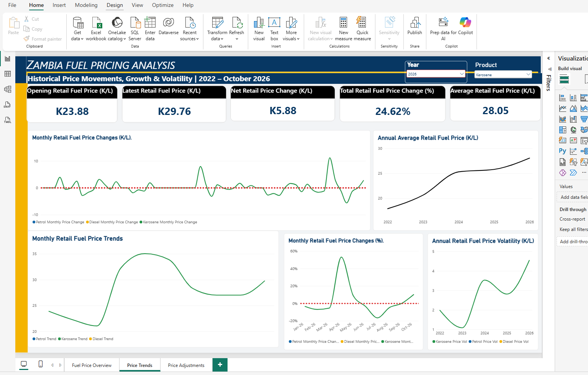
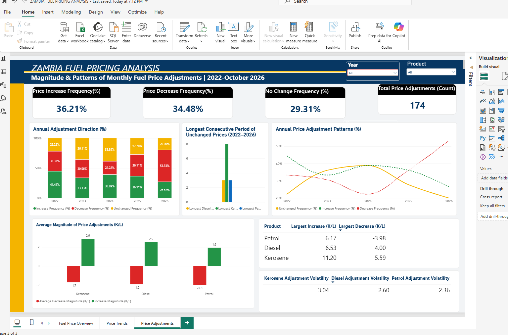

# Zambia Retail Fuel Pricing Analysis (Jan 2022 – Oct 2026)

An empirical analysis of monthly retail fuel-price adjustments in Zambia from **January 2022 through October 2026**, built using **Microsoft Excel** and **Power BI**.

> 📄 [**View Full Executive Summary (PDF)**](Executive_Summary/Zambia_Fuel_Pricing_Executive_Summary_2022-2026.pdf)

## Background & Research Question

Zambia transitioned from quarterly to monthly fuel-price reviews in January 2022. Since then, frequent pump-price revisions have prompted public debate—including remarks by President Hakainde Hichilema—around whether longer review intervals (such as two or three months) should be considered.

Rather than relying on anecdote, this project establishes a descriptive empirical baseline to answer:

> *What does Zambia's historical retail fuel-price experience reveal about the frequency, direction, magnitude, volatility, and stability of fuel-price adjustments, and how can this evidence contribute to discussions about alternative pricing-review intervals?*

## Dataset & Methodology

* **Data Source:** Energy Regulation Board (ERB) official monthly retail and wholesale fuel prices for **Petrol**, **Diesel**, and **Kerosene**.
* **Time Horizon & Sample Size:** **58 months** (January 2022 – October 2026), yielding **174 product-level observations** (one observation per product per month: **63 increases**, **60 decreases**, and **51 unchanged**).
* **Tools Used:**
  * **Microsoft Excel:** Data cleaning, validation, month-over-month price deltas (`K/L` and `%`), consecutive unchanged streak tracking, and standard deviation calculations.
  * **Power BI:** Relational data modeling, custom DAX measures, dynamic KPI cards, slicer interaction control, and a three-page interactive executive dashboard.
* **Methodological Note:** All percentage breakdowns represent shares of the **174 product-level observations**, not shares of calendar months.

## Key Findings

### 1. High Adjustment Frequency with Balanced Overall Direction

* Retail prices changed in **70.69%** of all observations (**123 of 174**) and remained unchanged in **29.31%** (**51 observations**).
* Overall directional frequency was nearly symmetrical: **36.21% increases** (63 observations) versus **34.48% decreases** (60 observations).

### 2. Asymmetric Adjustment Magnitudes

* While increases and decreases happened at similar frequencies, upward adjustments were substantially larger on average (**+10.42%**) than downward adjustments (**-6.83%**).
* In Kwacha terms, average increases outpaced decreases for **Kerosene** (`K2.9/L` vs. `K1.7/L`) and **Diesel** (`K2.5/L` vs. `K1.9/L`), whereas **Petrol** was nearly balanced (`K1.9/L` vs. `K2.0/L`).

### 3. Shifting Annual Adjustment Regimes

Adjustment direction shifted noticeably across calendar years—moving from upward-led regimes in 2022 and 2024 to a downward-led regime during January–October 2026:

| Year | Increase (%) | Decrease (%) | Unchanged (%) |
| :--- | :---: | :---: | :---: |
| **2022** | 44.44% | 33.33% | 22.22% |
| **2023** | 33.33% | 30.56% | 36.11% |
| **2024** | 38.89% | 22.22% | 38.89% |
| **2025** | 36.11% | 36.11% | 27.78% |
| **2026 (Jan–Oct)** | 26.67% | 53.33% | 20.00% |

### 4. Material Extremes & Product Volatility

* **Largest Single-Month Increases:**
  * **Kerosene:** `+53.18%` (`+K11.20/L`)
  * **Diesel:** `+28.09%` (`+K6.53/L`)
  * **Petrol:** `+24.40%` (`+K6.17/L`)
* **Largest Single-Month Decreases:** `-K5.59/L` (Kerosene), `-K4.00/L` (Diesel), and `-K3.98/L` (Petrol).
* **Adjustment Volatility:** The standard deviation of monthly adjustment sizes was highest for **Kerosene** (`K3.04/L`), followed by **Diesel** (`K2.60/L`) and **Petrol** (`K2.36/L`). *(Note: This measures variation in adjustment size rather than retail price-level volatility.)*

### 5. Product Stability & October 2026 Price Levels

* **Uninterrupted Stability:** The longest consecutive streaks of unchanged retail prices were **8 months** for Kerosene and **3 months** each for Petrol and Diesel.
* **October 2026 Snapshot:** Retail pump prices stood at **K31.46/L** (Petrol), **K33.27/L** (Diesel), and **K29.76/L** (Kerosene). Notably, Diesel climbed **+32.50%** (`+K8.16/L`, from `K25.11/L` to `K33.27/L`) over the first ten months of 2026 despite decreases accounting for 53.33% of all adjustments that year.
* **Retail vs. Wholesale:** Across 2022–2026 averages, retail prices exceeded wholesale prices for all three products.

## Power BI Dashboard Overview

The interactive Power BI report is organized into three analytical views with custom page navigation and Year/Product slicers:

### Page 1: Fuel Price Overview


* Executive KPI strip displaying latest October 2026 retail prices alongside 2022–2026 average upward and downward percentage adjustments.
* Multi-product retail price trend lines, overall directional share breakdown, average retail vs. wholesale price comparisons, and annual directional frequency curves.

### Page 2: Price Trends



* Dynamic Year and Product filtering comparing opening vs. latest retail prices, net Kwacha change, cumulative percentage growth, and period average price.
* Monthly `K/L` and `%` delta trajectories paired with multi-year retail price volatility curves.

### Page 3: Price Adjustments



* Granular breakdown of adjustment frequency across all 174 review observations, stacked annual directional shares, longest consecutive unchanged runs, asymmetric average adjustment magnitudes (`K/L`), and product-level extreme/volatility summary tables.

## Policy Implications & Limitations

* **Policy Context:** Under monthly reviews, retail fuel prices adjusted in roughly seven out of every ten product-month observations, moving in both directions and occasionally by large magnitudes. Extending the review interval would reduce how frequently price changes reach consumers and businesses, though potentially altering the size of each step change.
* **Analytical Boundaries:** This study is strictly descriptive. It does not simulate hypothetical two- or three-month pricing schedules, establish a causal link between review frequency and volatility, or isolate underlying cost drivers (international crude prices, ZMW/USD exchange rates, import logistics, and domestic taxes).
* **Next Steps:** Future iterations can build counterfactual simulations of 60-day and 90-day review intervals alongside external macroeconomic and petroleum-benchmark data.

## Repository Structure

```text
Zambia-Fuel-Price-Analysis/
├── README.md
├── Dashboard_Preview/
│   ├── 01_Fuel_Overview.jpg
│   ├── 02_Price_Trends.png
│   └── 03_Price_Adjustments.png
├── Data/
│   └── erb_retail_wholesale_fuel_prices_2022_2026.xlsx
├── Executive_Summary/
│   └── Zambia_Fuel_Pricing_Executive_Summary_2022-2026.pdf
└── PowerBI/
    └── Zambia_Fuel_Pricing_Analysis.pbix
```

## Author

**Boldwin Mweemba**  
Data Analyst | Lusaka, Zambia  
*Prepared November 2026*